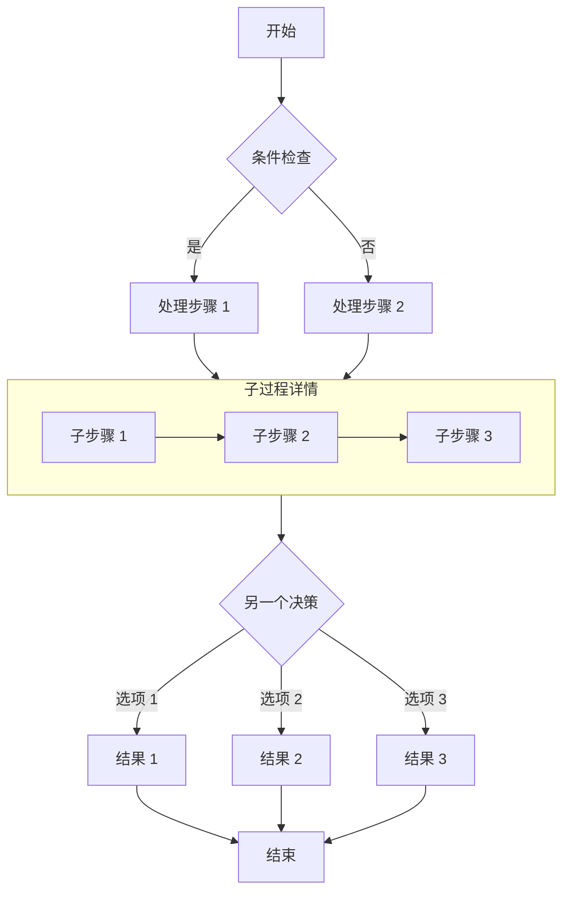

<a id="成功解锁了这篇文章" data-original-heading-id="成功解锁了这篇文章" data-translated-heading-id="you-have-unlocked-this-post"></a>
## You Have Unlocked This Post!

If you can read this, the password was correct and the post has been decrypted successfully.

<a id="功能说明" data-original-heading-id="功能说明" data-translated-heading-id="how-it-works"></a>
### How It Works

- **Build-time encryption**: Post content is encrypted with AES-256-GCM during the build. No plaintext content is included in the page source.
- **Client-side decryption**: After the visitor enters the correct password, the browser decrypts the content locally with the Web Crypto API.
- **Session caching**: The password is cached in `sessionStorage` for the current browser session, so refreshing the page does not require entering it again.
- **Expires on close**: Closing the browser clears the cache; the password must be entered again on the next visit.

> The password is `123456`, for testing only.

<a id="图片" data-original-heading-id="图片" data-translated-heading-id="images"></a>
## Images


<a id="github-仓库卡片" data-original-heading-id="github-仓库卡片" data-translated-heading-id="github-repository-cards"></a>
## GitHub Repository Cards

::github{repo="CuteLeaf/Firefly"}

<a id="提示框" data-original-heading-id="提示框" data-translated-heading-id="callouts"></a>
## Callouts

> [!NOTE] NOTE
> Highlights information that readers should take into account.

> [!TIP] TIP
> Optional information that helps readers achieve better results.

> [!NOTE] Custom Title
> This is an example with a custom title.

<a id="数学公式" data-original-heading-id="数学公式" data-translated-heading-id="mathematical-formulas"></a>
## Mathematical Formulas
<a id="行内公式-inline" data-original-heading-id="行内公式-inline" data-translated-heading-id="inline-equations"></a>
### Inline Equations

Euler's identity $e^{i\pi} + 1 = 0$ is one of the most beautiful formulas in mathematics.

The mass-energy equivalence equation $E = mc^2$ is also widely known.

<a id="块级公式-block" data-original-heading-id="块级公式-block" data-translated-heading-id="display-equations"></a>
### Display Equations

Display equations are enclosed in pairs of `$$` delimiters and are centered.

$$
\int_{-\infty}^{\infty} e^{-x^2} dx = \sqrt{\pi}
$$

$$
x = \frac{-b \pm \sqrt{b^2 - 4ac}}{2a}
$$

<a id="化学方程式-chemical-equations" data-original-heading-id="化学方程式-chemical-equations" data-translated-heading-id="chemical-equations"></a>
### Chemical Equations

$$
\ce{CH4 + 2O2 -> CO2 + 2H2O}
$$

<a id="代码块" data-original-heading-id="代码块" data-translated-heading-id="code-blocks"></a>
## Code Blocks
<a id="常规语法高亮" data-original-heading-id="常规语法高亮" data-translated-heading-id="regular-syntax-highlighting"></a>
#### Regular Syntax Highlighting

```js
console.log('此代码有语法高亮!')
```

<a id="渲染-ansi-转义序列" data-original-heading-id="渲染-ansi-转义序列" data-translated-heading-id="rendering-ansi-escape-sequences"></a>
#### Rendering ANSI Escape Sequences

```ansi
ANSI colors:
- Regular: Red Green Yellow Blue Magenta Cyan
- Bold:    Red Green Yellow Blue Magenta Cyan
- Dimmed:  Red Green Yellow Blue Magenta Cyan

256 colors (showing colors 160-177):
160 161 162 163 164 165
166 167 168 169 170 171
172 173 174 175 176 177

Full RGB colors:
ForestGreen - RGB(34, 139, 34)

Text formatting: Bold Dimmed Italic Underline
```


<a id="流程图" data-original-heading-id="流程图" data-translated-heading-id="flowcharts"></a>
## Flowcharts

