<a id="markdown-中-mermaid-图表完整指南" data-original-heading-id="markdown-中-mermaid-图表完整指南" data-translated-heading-id="a-complete-guide-to-mermaid-diagrams-in-markdown"></a>
## A Complete Guide to Mermaid Diagrams in Markdown

This article demonstrates how to create diagrams in Markdown with Mermaid, including flowcharts, sequence diagrams, ER diagrams, class diagrams, state diagrams, XY charts, Gantt charts, mind maps, and more.

> Mermaid diagrams are powered by [Merman](https://github.com/Latias94/merman). Firefly generates separate light and dark static SVGs during the Astro build, so no Mermaid rendering runtime is loaded in the browser. Visit [Merman Playground](http://frankorz.com/merman/) to edit the syntax and preview the results interactively.

<a id="流程图示例" data-original-heading-id="流程图示例" data-translated-heading-id="flowchart-example"></a>
## Flowchart Example

Flowcharts are well suited to describing processes and algorithm steps.


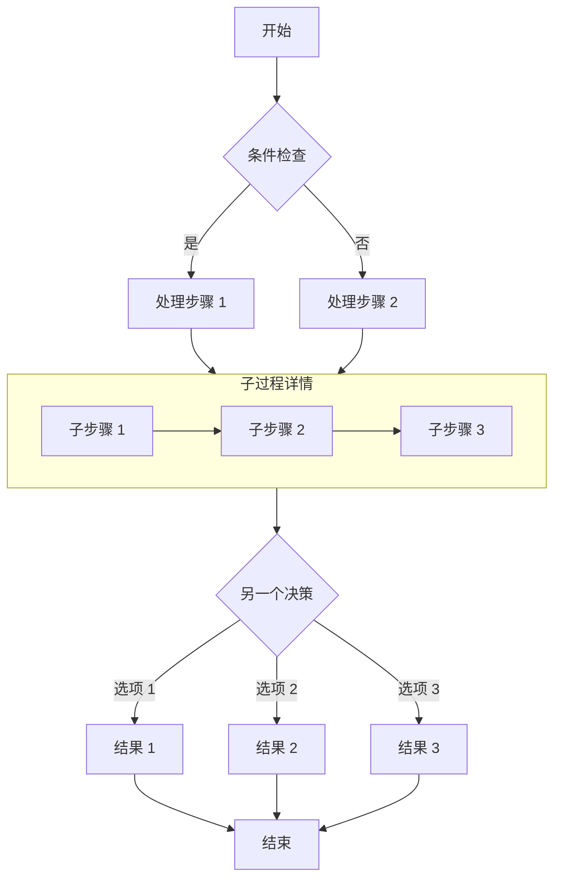

<a id="时序图示例" data-original-heading-id="时序图示例" data-translated-heading-id="sequence-diagram-example"></a>
## Sequence Diagram Example

Sequence diagrams show how objects interact over time.

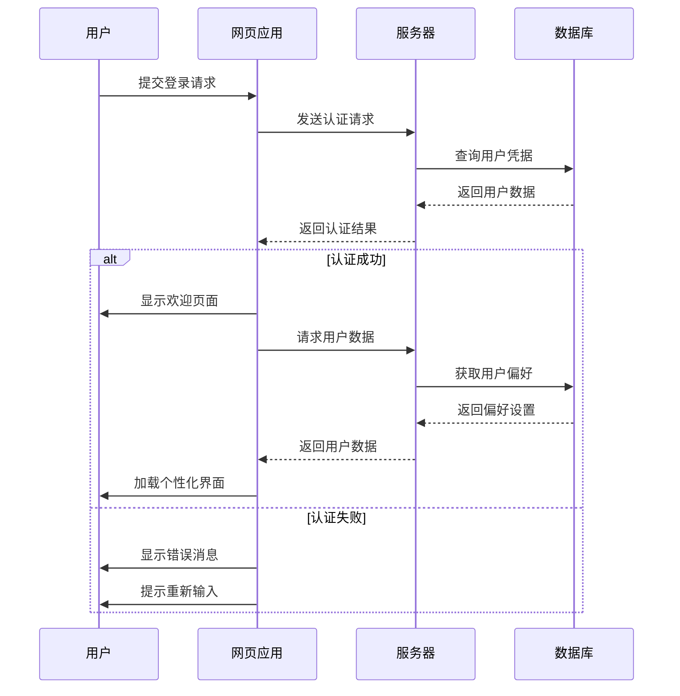

<a id="er-图示例" data-original-heading-id="er-图示例" data-translated-heading-id="er-diagram-example"></a>
## ER Diagram Example

ER diagrams, or entity-relationship diagrams, are useful for representing database structures.

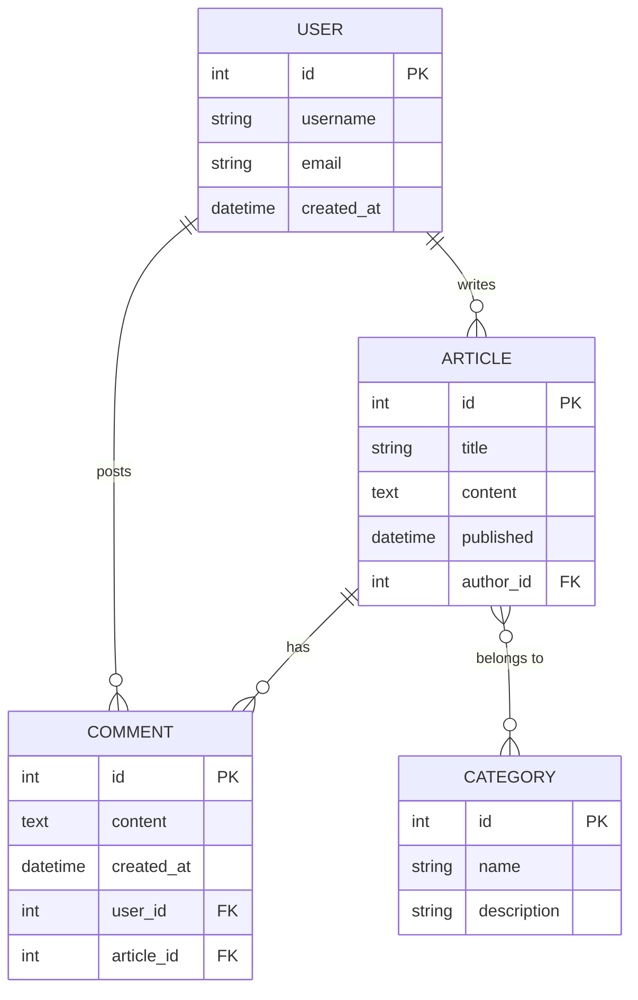

<a id="类图示例" data-original-heading-id="类图示例" data-translated-heading-id="class-diagram-example"></a>
## Class Diagram Example

Class diagrams show the static structure of a system, including classes, properties, methods, and their relationships.

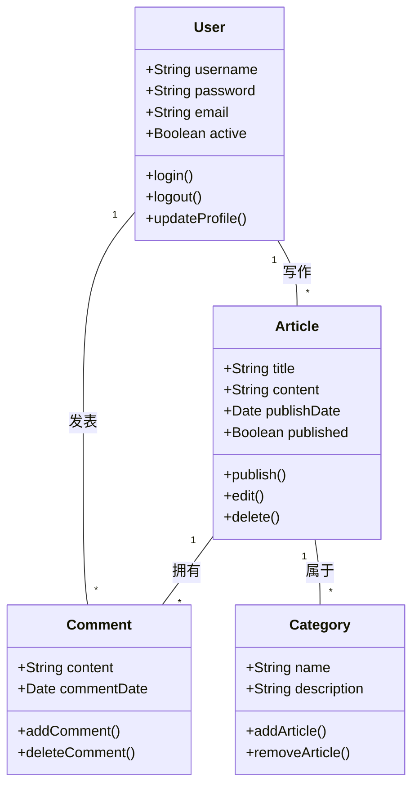

<a id="状态图示例" data-original-heading-id="状态图示例" data-translated-heading-id="state-diagram-example"></a>
## State Diagram Example

State diagrams show the sequence of states an object passes through during its lifecycle.

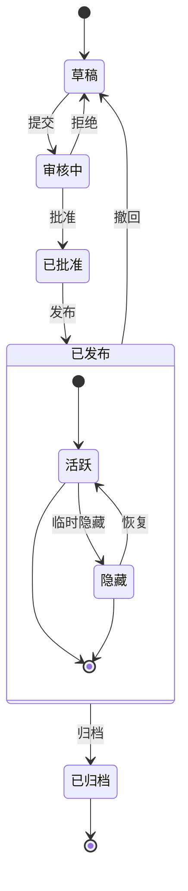

<a id="xy-图示例" data-original-heading-id="xy-图示例" data-translated-heading-id="xy-chart-example"></a>
## XY Chart Example

XY charts are useful for displaying trends and comparing data.

```mermaid
xychart-beta
    title "月度访问量趋势"
    x-axis [1月, 2月, 3月, 4月, 5月, 6月]
    y-axis "访问量" 0 --> 5000
    bar [2500, 3200, 4100, 3800, 4500, 4800]
    line [2500, 3200, 4100, 3800, 4500, 4800]
```

<a id="饼图示例" data-original-heading-id="饼图示例" data-translated-heading-id="pie-chart-example"></a>
## Pie Chart Example

Pie charts clearly show each part's proportion of a whole.

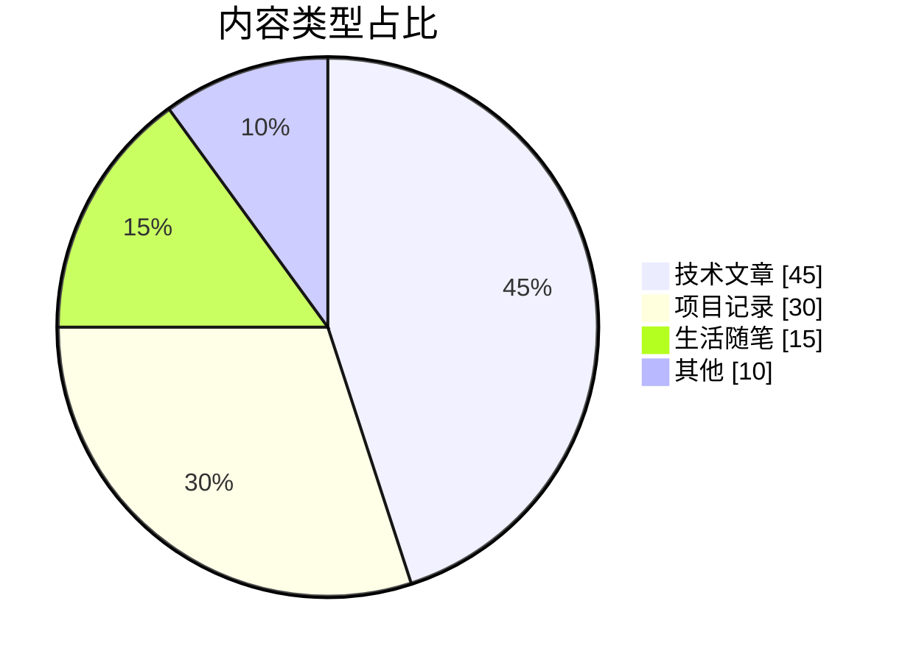

<a id="甘特图示例" data-original-heading-id="甘特图示例" data-translated-heading-id="gantt-chart-example"></a>
## Gantt Chart Example

Gantt charts show project phases, task dependencies, and current progress on a timeline.

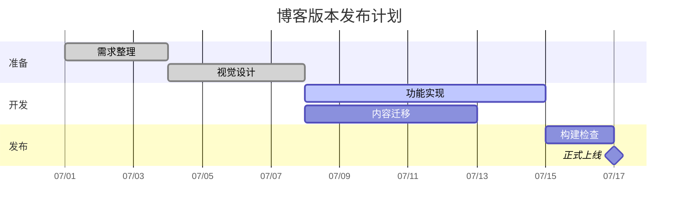

<a id="思维导图示例" data-original-heading-id="思维导图示例" data-translated-heading-id="mind-map-example"></a>
## Mind Map Example

Mind maps help organize topic hierarchies and knowledge structures.

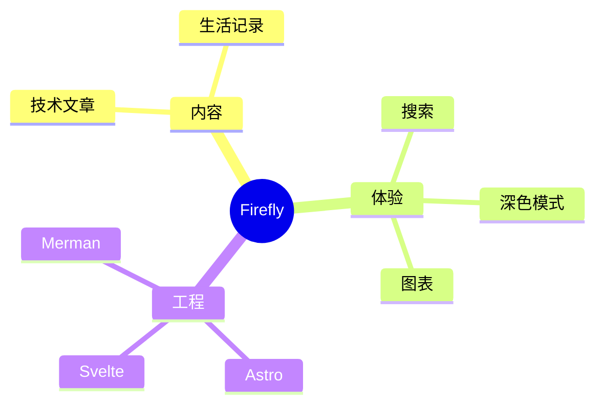

<a id="时间线示例" data-original-heading-id="时间线示例" data-translated-heading-id="timeline-example"></a>
## Timeline Example

Timelines present important project events by year or phase.

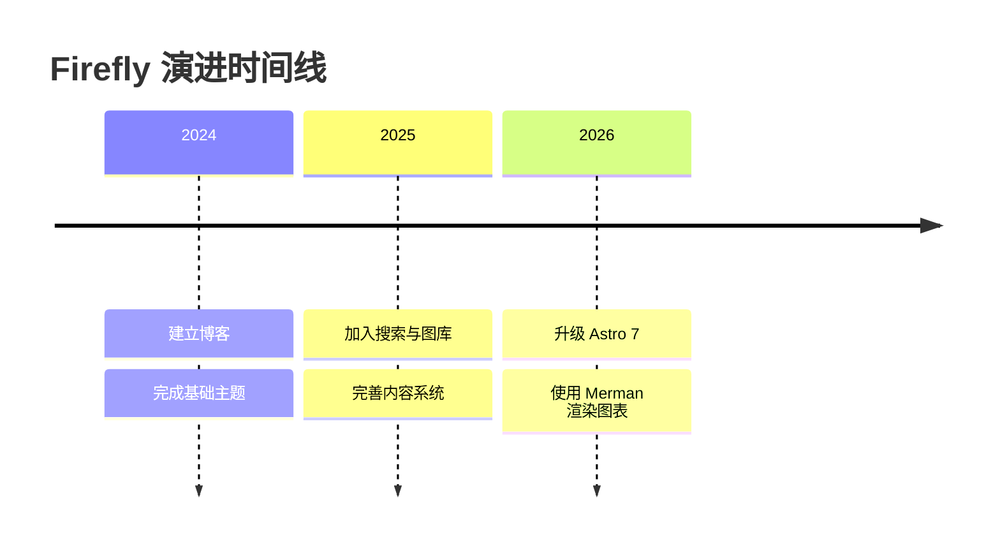

<a id="用户旅程图示例" data-original-heading-id="用户旅程图示例" data-translated-heading-id="user-journey-example"></a>
## User Journey Example

User journey diagrams describe user actions and experience scores at different stages.

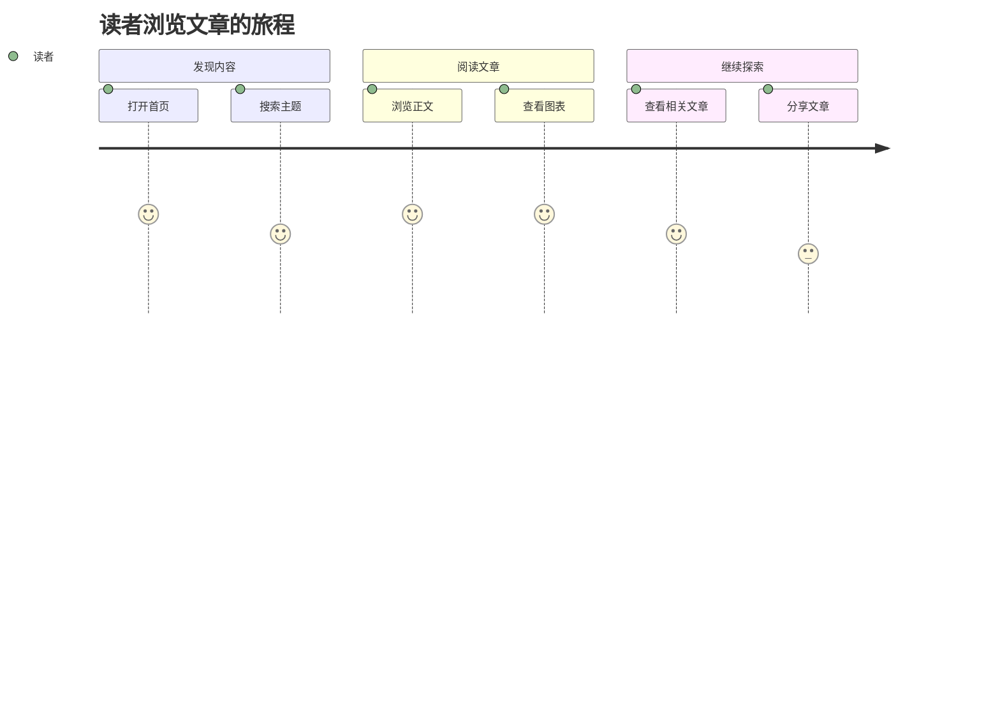

<a id="git-图示例" data-original-heading-id="git-图示例" data-translated-heading-id="git-graph-example"></a>
## Git Graph Example

Git graphs clearly show branches, commits, and merge history.

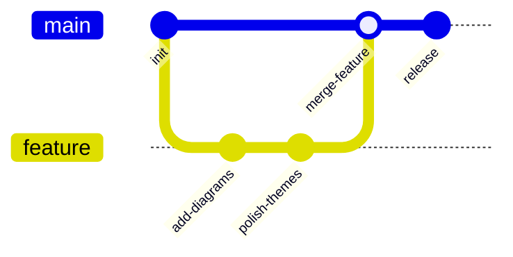

<a id="看板示例" data-original-heading-id="看板示例" data-translated-heading-id="kanban-example"></a>
## Kanban Example

Kanban boards show how tasks are distributed across workflow stages.

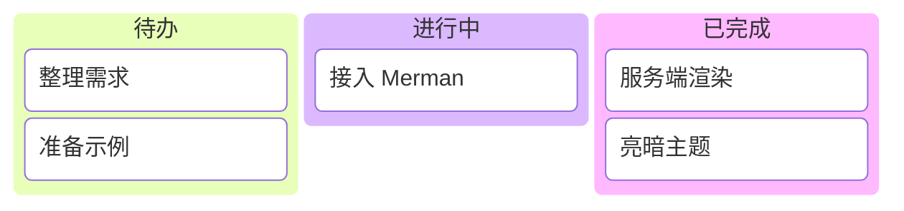

<a id="sankey-图示例" data-original-heading-id="sankey-图示例" data-translated-heading-id="sankey-diagram-example"></a>
## Sankey Diagram Example

Sankey diagrams use link widths to represent the amount of flow between nodes.

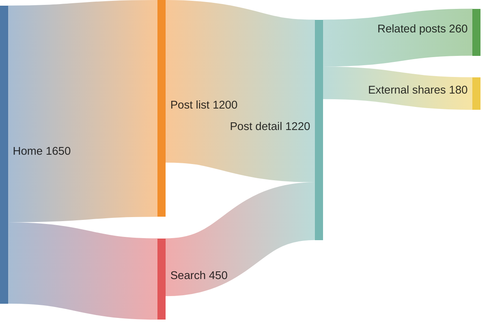

<a id="总结" data-original-heading-id="总结" data-translated-heading-id="summary"></a>
## Summary

Mermaid is a powerful tool for creating many kinds of diagrams in Markdown. This article demonstrated flowcharts, sequence diagrams, ER and class diagrams, state diagrams, XY and pie charts, Gantt charts, mind maps, timelines, user journeys, Git graphs, Kanban boards, and Sankey diagrams. These diagrams help explain complex concepts, processes, and data structures more clearly.

To use Mermaid, specify the mermaid language on a fenced code block and describe your diagram with its concise text syntax. Diagrams are automatically rendered to SVG at build time, without loading client-side JavaScript.

Try more syntax in [Merman Playground](http://frankorz.com/merman/) and then paste the diagram code into your article.
