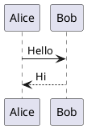
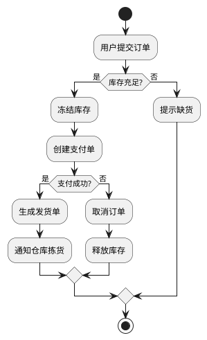
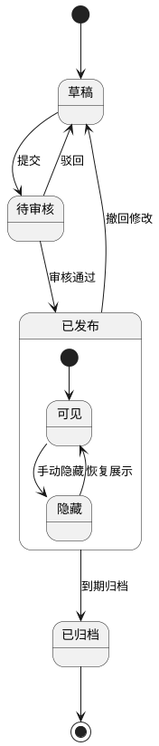
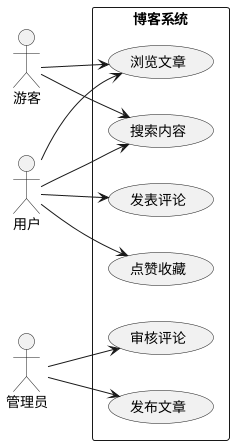
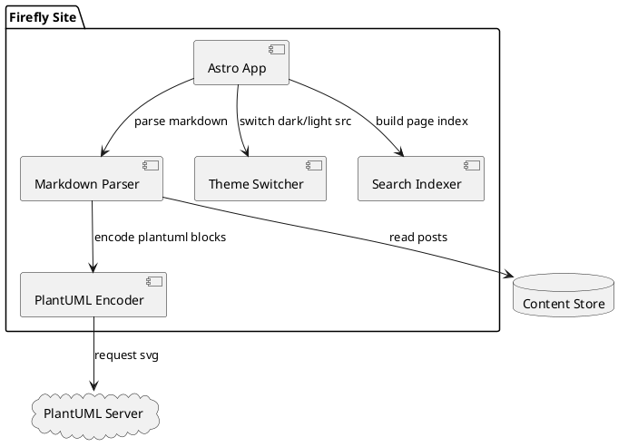
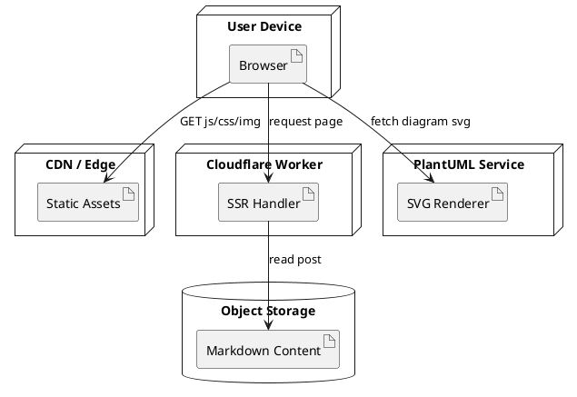
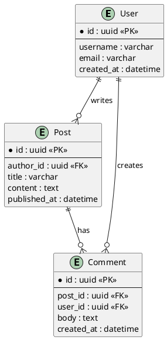
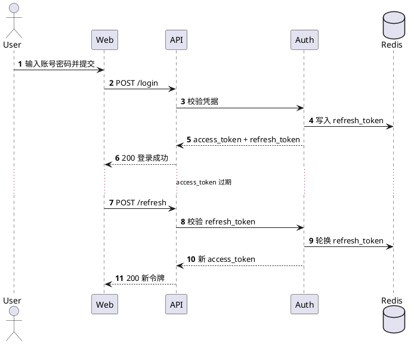

<a id="markdown-中-plantuml-图表指南" data-original-heading-id="markdown-中-plantuml-图表指南" data-translated-heading-id="a-guide-to-plantuml-diagrams-in-markdown"></a>
## A Guide to PlantUML Diagrams in Markdown

PlantUML describes diagrams in plain text. Write a short structured definition to generate sequence, class, use case, activity, and other engineering diagrams.

It is especially useful in technical blogs and project documentation:

- Version diagrams alongside the article for easier collaboration and review
- Update diagrams by editing text, making frequent iteration straightforward
- Integrate seamlessly with Markdown to keep documentation consistent

In Firefly, `plantuml` code blocks are encoded at build time to generate server SVG URLs. The page switches diagram sources automatically with the light or dark theme and supports zooming, dragging, and fullscreen viewing.

To get started quickly, use this minimal template:



<a id="活动图示例" data-original-heading-id="活动图示例" data-translated-heading-id="activity-diagram-example"></a>
## Activity Diagram Example



<a id="状态图示例" data-original-heading-id="状态图示例" data-translated-heading-id="state-diagram-example"></a>
## State Diagram Example



<a id="用例图示例" data-original-heading-id="用例图示例" data-translated-heading-id="use-case-diagram-example"></a>
## Use Case Diagram Example



<a id="组件图示例" data-original-heading-id="组件图示例" data-translated-heading-id="component-diagram-example"></a>
## Component Diagram Example



<a id="部署图示例" data-original-heading-id="部署图示例" data-translated-heading-id="deployment-diagram-example"></a>
## Deployment Diagram Example



<a id="er-图示例" data-original-heading-id="er-图示例" data-translated-heading-id="er-diagram-example"></a>
## ER Diagram Example



<a id="时序图示例登录与刷新令牌" data-original-heading-id="时序图示例登录与刷新令牌" data-translated-heading-id="sequence-diagram-example-sign-in-and-token-refresh"></a>
## Sequence Diagram Example: Sign-in and Token Refresh



<a id="c4-风格容器图示例" data-original-heading-id="c4-风格容器图示例" data-translated-heading-id="c4-style-container-diagram-example"></a>
## C4-style Container Diagram Example

```plantuml
@startuml
!includeurl https://raw.githubusercontent.com/plantuml-stdlib/C4-PlantUML/master/C4_Container.puml

Person(user, "博客访客", "阅读文章与搜索内容")

System_Boundary(system, "Firefly Blog") {
	Container(web, "Web App", "Astro + Svelte", "渲染页面与交互")
	Container(worker, "SSR Worker", "Cloudflare Workers", "处理服务端渲染请求")
	ContainerDb(content, "Content Store", "Markdown / Object Storage", "存储文章与资源元数据")
	Container(search, "Search Index", "Pagefind", "提供全文检索")
}

System_Ext(plantuml, "PlantUML Server", "生成 SVG 图表")

Rel(user, web, "访问", "HTTPS")
Rel(web, worker, "请求 SSR 页面", "HTTPS")
Rel(worker, content, "读取文章")
Rel(web, search, "查询关键词")
Rel(web, plantuml, "请求图表 SVG")

LAYOUT_LEFT_RIGHT()
@enduml
```

